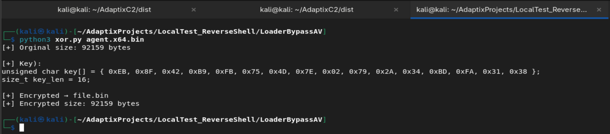
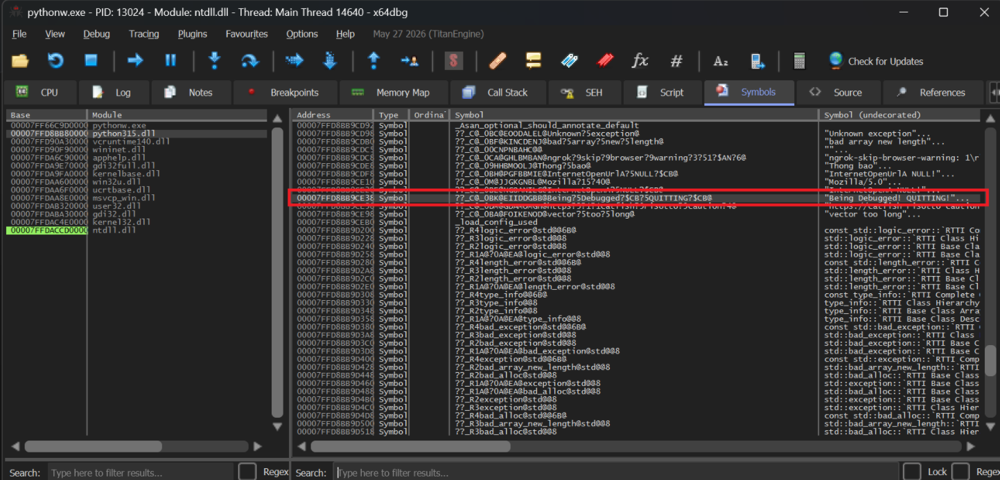

# DLL Sideloading & AV/EDR Evasion Research

## Overview

This project explores DLL Sideloading using `pythonw.exe` and `python315.dll` as part of Windows loader research.

The objective is to investigate how a legitimate application can load an unintended DLL and how this behavior can be studied in the context of Antivirus (AV) and Endpoint Detection and Response (EDR) solutions.

The project also explores techniques commonly discussed in malware analysis and defensive security research, including payload encryption, anti-debugging, anti-sandbox mechanisms, and sleep-based evasion.

## Technical Concepts

- **DLL Sideloading:** Exploiting DLL loading behavior to make a legitimate application load an unintended DLL.
- **Download Shellcode From URL:** Download shellcode from a remote URL to avoid storing hardcoded shellcode on disk."
- **Payload Encryption:** Exploring XOR and AES encryption to protect payload data at rest.
- **Anti-Debugging:** Studying techniques used to detect debugger presence.
- **Sleep Evasion:** Investigating execution delays and their impact on behavioral monitoring.

## AV/EDR Research

The research examines:
- DLL Sideloading detection.
- Static versus behavioral detection.
- Security telemetry generated during execution.
- Detection differences between legitimate and suspicious DLL loading behavior.

## Demonstration

The demonstration illustrates the DLL loading process and the AV/EDR detection results observed during controlled testing.

[Figure 1. Python DLL Sideloading demonstration](https://github.com/noname2kz/Loader_BypassAV/blob/main/assets/bypassAV.gif)

Payload Encryption:

Anti-Debug Demonstration

## Source Code

The implementation is intentionally not publicly disclosed. This repository focuses on technical research, execution flow, and demonstration results.
